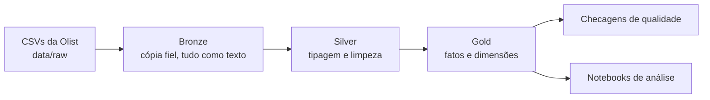
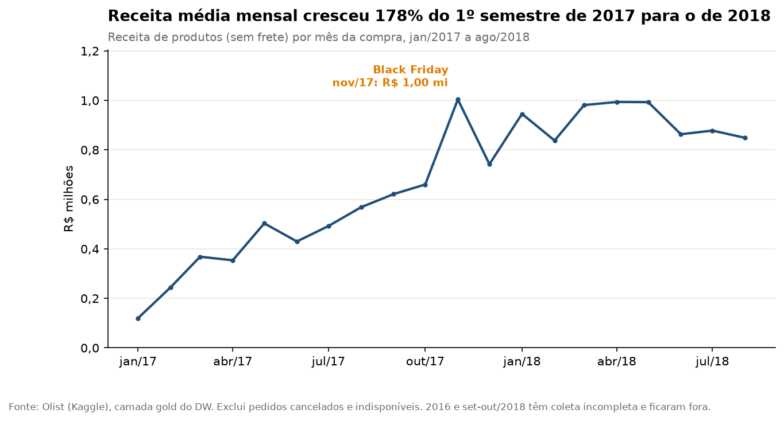
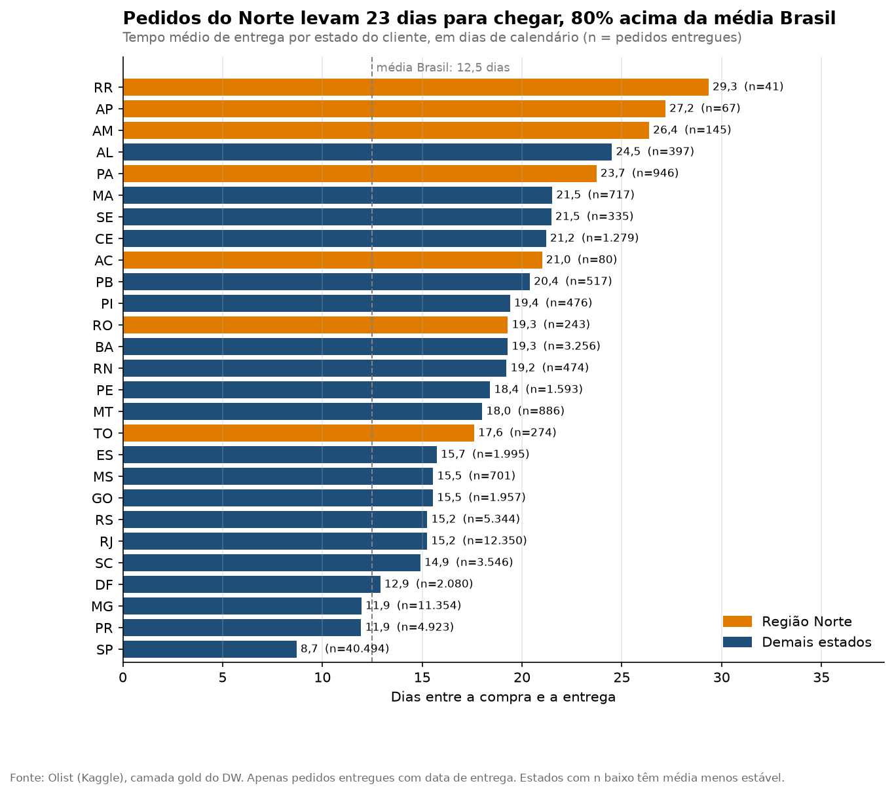
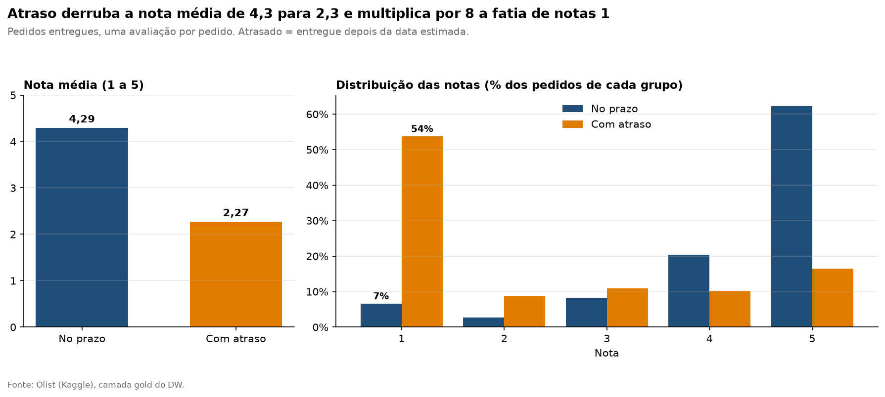
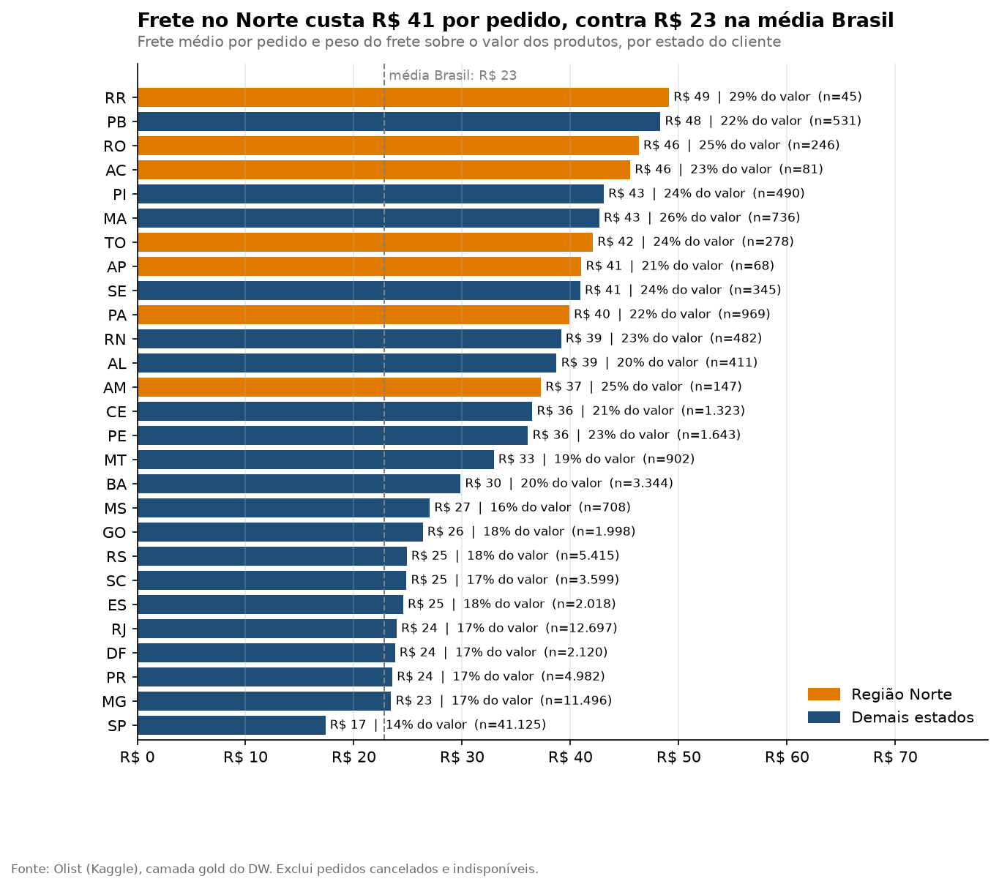
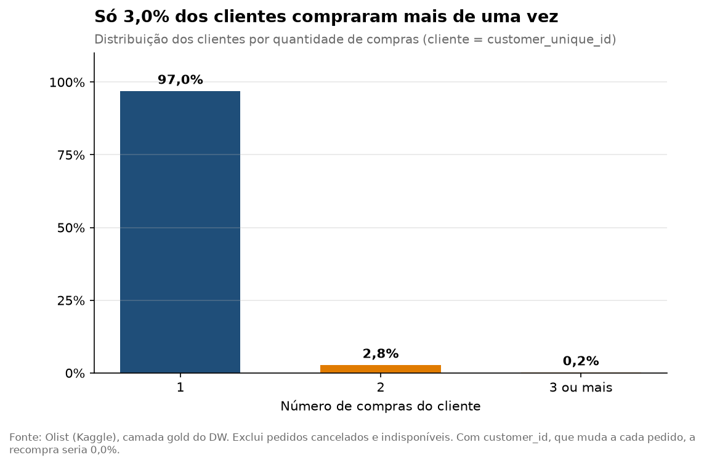

# Desafio Técnico Data Engineer I: Pipeline de Dados Olist

Pipeline ELT que transforma os dados públicos do marketplace Olist em um mini Data Warehouse em DuckDB, organizado em camadas bronze, silver e gold, com checagens automáticas de qualidade e análises exploratórias.

## Visão geral

- **Stack:** Python 3.13, DuckDB, SQL, pandas, matplotlib e Jupyter.
- **Arquitetura:** medalhão (bronze, silver e gold), com modelo dimensional na camada gold.
- **Execução:** um único comando gera o Data Warehouse do zero em cerca de 5 segundos.



## Estrutura do projeto

```
desafio-olist/
├── data/raw/                 # CSVs originais (não versionados)
├── docs/img/                 # gráficos gerados pelas análises
├── notebooks/
│   ├── 01_perfilamento.ipynb # investigação da camada bronze e regras de qualidade
│   └── 02_analises.ipynb     # análises exploratórias com gráficos
├── sql/
│   ├── silver/               # um .sql por tabela limpa
│   └── gold/                 # fatos e dimensões
├── src/
│   ├── config.py             # caminhos e nomes centralizados
│   ├── bronze.py             # ingestão dos CSVs
│   ├── layers.py             # executor das camadas SQL (silver e gold)
│   ├── quality.py            # checagens automáticas de qualidade
│   └── pipeline.py           # ponto de entrada
└── requirements.txt
```

## Como executar do zero

**Pré-requisitos:** Python 3.11 ou superior, Git e uma conta no Kaggle para baixar os dados.

1. Clone o repositório e entre na pasta:
   ```bash
   git clone https://github.com/LuanRob/desafio-olist.git
   cd desafio-olist
   ```
2. Crie e ative o ambiente virtual:
   ```bash
   python -m venv .venv
   # Windows (PowerShell)
   .venv\Scripts\Activate.ps1
   # Linux ou macOS
   source .venv/bin/activate
   ```
3. Instale as dependências:
   ```bash
   pip install -r requirements.txt
   ```
4. Baixe o [Brazilian E-Commerce Public Dataset by Olist](https://www.kaggle.com/datasets/olistbr/brazilian-ecommerce/data) e extraia os 9 arquivos CSV em `data/raw/`, sem alterar os nomes.
5. Execute o pipeline:
   ```bash
   python src/pipeline.py
   ```
   O banco é criado em `data/olist.duckdb`. O log mostra a contagem de linhas de cada tabela e o resultado das 12 checagens de qualidade.
6. Abra os notebooks em `notebooks/`, selecionando o Python da `.venv` como kernel.

## Decisões de modelagem

**Camadas (medalhão).** Cada camada tem uma responsabilidade, o que dá rastreabilidade: é possível ver o dado em cada etapa e voltar à origem de qualquer número.

| Camada | Responsabilidade |
|---|---|
| Bronze | Cópia fiel dos CSVs, com todas as colunas como texto e colunas de controle (`_source_file` e `_ingested_at`). A carga nunca falha por tipo inválido. |
| Silver | Tipagem e limpeza: datas, valores, deduplicação, tradução de categorias. Não aplica regras de negócio. |
| Gold | Modelo dimensional e regras de negócio (o que conta como venda, quais pedidos entram nas métricas de entrega). |

**Regras em SQL, orquestração em Python.** Cada tabela é um arquivo `.sql`, e o nome do arquivo é o nome da tabela. O Python só define a ordem de execução, por meio de um executor genérico usado pela silver e pela gold.

**Uma tabela fato por grão.** Um pedido pode ter vários itens e vários pagamentos. Juntar tudo numa tabela única duplicaria valores, então cada fato tem o seu grão:

| Tabela | Grão | Linhas | Uso |
|---|---|---|---|
| `fact_order_items` | um item vendido | 112.650 | vendas e receita por categoria |
| `fact_orders` | um pedido | 99.441 | entrega, atraso, satisfação e recompra (tabela derivada com prazo e atraso em dias) |
| `fact_payments` | um pagamento | 103.883 | meios de pagamento |
| `dim_customers` | um cliente por pedido | 99.441 | estado e `customer_unique_id` |
| `dim_products` | um produto | 32.951 | categoria em português e em inglês |
| `dim_sellers` | um vendedor | 3.095 | estado do vendedor |

Os pedidos cancelados e indisponíveis **não são apagados**: são marcados com a flag `is_valid_sale`. As análises de receita filtram pela flag, e os dados continuam disponíveis para estudar cancelamentos. Não foi criada uma dimensão de datas porque o DuckDB extrai mês e ano diretamente das datas, e ela seria complexidade sem ganho neste escopo.

## Regras de qualidade

As regras foram definidas a partir do perfilamento da camada bronze, documentado em `notebooks/01_perfilamento.ipynb`, com a evidência de cada uma.

| Achado no perfilamento | Tratamento |
|---|---|
| 547 pedidos com 2 ou 3 avaliações | Mantida uma avaliação por pedido, a mais recente |
| 610 produtos sem categoria | Categoria `sem_categoria` |
| 2 categorias sem tradução (13 produtos) | Traduzidas manualmente |
| 625 pedidos cancelados e 609 indisponíveis | Fora do cálculo de receita (flag `is_valid_sale`) |
| 8 pedidos entregues sem data de entrega | Fora apenas das métricas de prazo e atraso |
| 99.441 `customer_id` para 96.096 clientes reais | Recompra calculada com `customer_unique_id` |
| 3 pagamentos `not_defined`, com valor zero | Removidos |
| Meses com coleta incompleta (2016 e set-out/2018) | Fora das análises mensais |
| Colunas com erro de digitação na origem (`lenght`) | Renomeadas |
| Datas e valores armazenados como texto | Convertidos para `TIMESTAMP`, `DATE` e `DECIMAL`, após validar com `TRY_CAST` que não havia valores inválidos |

**Checagens automáticas.** Ao final de cada execução, `src/quality.py` roda 12 checagens. Cada uma conta os registros que violam uma regra, e o esperado é zero. Elas cobrem unicidade de chaves, integridade referencial entre fatos e dimensões e a aplicação das regras acima. Se uma checagem bloqueante falhar, o pipeline é interrompido, para que dado errado não chegue às análises.

## Premissas

- **Receita** é a soma do `price` dos itens, sem frete, de pedidos que não foram cancelados nem ficaram indisponíveis. O `payment_value` não foi usado como receita porque inclui o frete.
- **Prazo de entrega** são os dias de calendário entre a compra e a entrega ao cliente.
- **Atraso** é a entrega ao cliente depois da data estimada.
- **Frete médio** é calculado por pedido (soma do frete dos itens), porque o cliente paga o frete do pedido.
- **Cliente** é identificado pelo `customer_unique_id`, porque o `customer_id` é gerado a cada pedido.

## Limitações

- **Não há custo dos produtos**, então não é possível calcular margem ou lucro. As análises financeiras se limitam a receita e frete.
- **Estados com poucos pedidos** (por exemplo, 41 em RR e 67 em AP) têm médias menos estáveis. Os gráficos por estado mostram o número de pedidos (`n`) para deixar isso visível.
- **6 pedidos cancelados têm data de entrega**, provavelmente cancelamentos depois da entrega. Ficaram como cancelados, e as métricas de entrega consideram apenas pedidos com status `delivered`.
- **6 pagamentos com voucher têm valor zero**. Foram mantidos por serem possivelmente cupons de 100%, sem fonte para confirmar.
- A escolha da avaliação mais recente, nos pedidos com mais de uma avaliação, é uma premissa. Não há informação sobre qual avaliação é a válida.
- A geolocalização foi carregada na bronze, mas não foi usada nas análises.
- Os dados cobrem de 2016 a 2018 e representam apenas a Olist, sem refletir o mercado atual.

## Resultados das análises

Uma pergunta de cada tópico, respondida com consultas à camada gold. O detalhamento está em `notebooks/02_analises.ipynb`.

### Tópico 1: Vendas. Como a receita total varia mês a mês?


A receita de produtos cresceu 178% entre o 1º semestre de 2017 e o de 2018, com pico de R$ 1,0 mi em novembro de 2017, 52% acima de outubro, efeito da Black Friday. Em 2018 a receita se estabilizou perto de R$ 0,9 mi por mês e recuou levemente a partir de junho.

### Tópico 2: Logística. Qual o tempo médio de entrega, em dias, por estado?


O prazo vai de 8,7 dias em SP a 29,3 dias em RR. Os três estados mais lentos são do Norte, onde os pedidos levam em média 22,5 dias, contra 12,5 dias no Brasil.

### Tópico 3: Satisfação. Pedidos atrasados têm nota média menor?


Sim. A nota média cai de 4,29 para 2,27 nos pedidos atrasados, e 54% deles recebem nota 1, contra 7% dos entregues no prazo.

### Tópico 4: Financeiro. Qual o valor médio do frete por estado do cliente?


O frete médio por pedido vai de R$ 17 em SP a R$ 49 em RR. No Norte, a média é de R$ 41, 81% acima da média Brasil (R$ 23), e chega a 28,5% do valor dos produtos em RR.

### Tópico 5: Clientes. Qual a porcentagem de clientes que compraram mais de uma vez?


Apenas 3,0% dos clientes compraram mais de uma vez. Usando o `customer_id`, que muda a cada pedido, a recompra apareceria como 0%.

## Tópico com maior afinidade

**Logística.** Trabalho como assistente de e-commerce na Bemol, atendendo o interior do Amazonas, onde boa parte das entregas depende de rios e igarapés e o período de seca pode travar a operação. Os dados da Olist mostram esse padrão na Região Norte: o cliente espera 80% mais pela entrega e paga 81% mais de frete do que a média do país.

## Uso de IA

Usei o **Claude (Anthropic)** como assistente durante todo o projeto, em uma conversa contínua ao longo de cinco dias. Abaixo, o que veio da ferramenta, o que veio de mim e como validei o resultado.

### Como a IA ajudou, por etapa

| Etapa | Contribuição da IA | Meu trabalho |
|---|---|---|
| Desenho | Propôs a arquitetura medalhão com modelo dimensional na gold, a separação "regras em SQL, orquestração em Python" e o desenho de uma tabela fato por grão | Aprovei o desenho depois de entender cada decisão, para conseguir justificá-la |
| Ambiente e Git | Orientou a configuração (venv, `.gitignore`, `requirements.txt` só com as dependências diretas) e as convenções de commit | Configurei, publiquei o repositório como privado e mantive commits pequenos, um por etapa validada |
| Perfilamento | Sugeriu as consultas de verificação (chaves, nulos, status, categorias, avaliações, clientes, pagamentos e período) | Executei, analisei os resultados e pedi a inclusão das etapas de descoberta da estrutura |
| Pipeline | Propôs o código da bronze, os SQLs da silver e da gold, as checagens de qualidade e a refatoração para um executor genérico de camadas | Digitei todo o código, executei e depurei os erros até cada camada bater com os números esperados |
| Análises | Propôs as consultas e os gráficos e revisou a apresentação (títulos com o insight, formato brasileiro, número de pedidos por estado) | Conferi se cada gráfico respondia exatamente à pergunta do desafio e escrevi as conclusões a partir dos meus resultados |
| Documentação | Ajudou a estruturar e revisar o texto do perfilamento e deste README | Revisei e ajustei o conteúdo para refletir o que fiz |

### O que veio de mim

- **Rastreabilidade do perfilamento:** percebi que o notebook verificava colunas que ele mesmo não tinha mostrado de onde vieram, e incluí as etapas de descoberta (inventário das tabelas, lista de colunas e amostra dos dados) antes das verificações.
- **Cuidado com a bronze:** questionei suposições como "os valores da Olist são limpos". Como a bronze ainda não está validada, a verificação passou a usar `TRY_CAST`, que mede os valores inválidos em vez de assumir que não existem.
- **Validação incremental:** propus testar cada SQL ao terminar e commitar só o que estivesse validado.
- **Responsabilidade das camadas:** questionei se usar pandas no notebook significaria corrigir dado fora do pipeline. Isso levou à regra que segui: regras de negócio ficam no pipeline, e o notebook só consulta a gold e formata os resultados.
- **Contexto de negócio:** a leitura logística das análises (entregas por rios e igarapés, impacto da seca, frete que inviabiliza produtos de médio e grande porte) vem da minha experiência no e-commerce da Bemol no interior do Amazonas.

### Como validei

- **Validação por expectativa:** antes de rodar cada camada, o perfilamento já indicava quantas linhas cada tabela deveria ter (por exemplo, 98.673 avaliações depois da deduplicação). Todas as contagens bateram.
- **Checagens automáticas:** as 12 regras de `src/quality.py` passam a cada execução.
- **Revisão crítica, inclusive do que a IA sugeriu:** um título de gráfico sugerido pela IA saiu com o texto quebrado, porque o matplotlib interpretou dois símbolos `R$` como fórmula matemática; identifiquei o problema revisando as imagens geradas, e ele foi corrigido. Também conferi cada número das conclusões direto no resultado do notebook, o que corrigiu valores que eu tinha anotado errado num primeiro rascunho.

## Autor

**Luan Robert** · [LinkedIn](https://www.linkedin.com/in/luan-robert-dados/)
